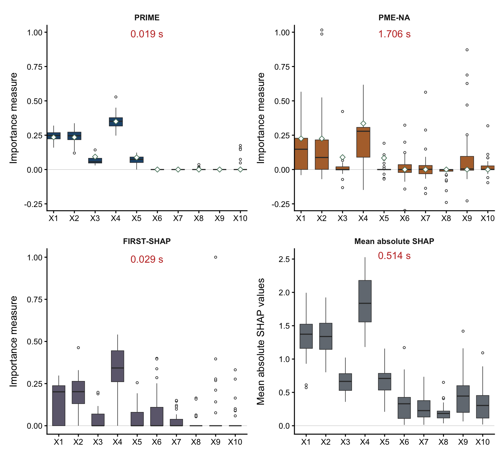
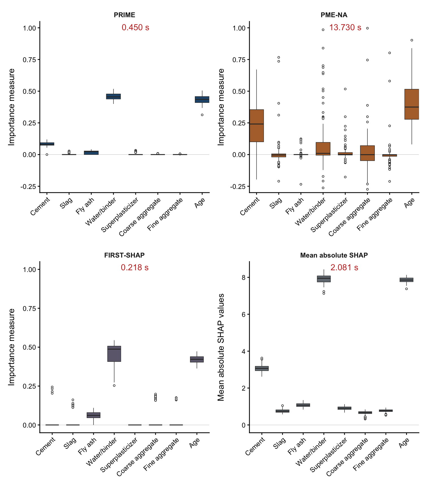

# PRIME: A New Measure for Variable Importance

[Paper](https://arxiv.org/abs/2610.17053) · [Install](#install) · [Examples](#quick-start)

## Why PRIME?


PRIME measures which inputs explain a response and how much each contributes, even when observations are noisy and inputs are correlated. It estimates **proportional marginal effects (PME)**: under the paper's identifiability conditions, redundant inputs receive zero population importance. This addresses a limitation of Shapley effects, which can give substantial credit to correlated proxies.

<p align="center"></p>

**A correlated proxy.** In **m(X) = X₁ + X₂ + βX₃**, the inputs are jointly Gaussian with standard-normal marginals; X₁ and X₃ have correlation ρ with |ρ| < 1, and X₂ is independent. At β = 0, the regression mean does not depend on X₃: its Shapley effect is ρ²/4, while its PME is zero.

PRIME estimates these signal contributions from observed data, assigning zero outside the selected set. The paper establishes consistency under its estimation and selection conditions; restricting allocation to selected inputs also reduces the cost of exact computation.

## Results


**Friedman function.** Importance estimates for five active inputs and five correlated proxies, based on 30 simulated datasets (n = 100, ρ = 0.9).

<p align="center"></p>

**Concrete compressive strength.** Importance estimates for eight concrete predictors, based on 100 repeated samples of 824 observations.

<p align="center"></p>

## Install

### R

```r
install.packages("remotes")
remotes::install_github("ChoYoungSeo/prime-importance-r", upgrade = "never")
```

[R reference manual (PDF)](https://raw.githubusercontent.com/ChoYoungSeo/prime-importance-r/main/docs/prime.pdf)

### Python

```sh
python -m pip install "prime-importance[plot]"
```

[PyPI](https://pypi.org/project/prime-importance/)

## Quick start

### R

```r
library(prime)
set.seed(5)
X <- matrix(runif(300 * 8, -1, 1), nrow = 300)
colnames(X) <- paste0("X", seq_len(ncol(X)))
y <- X[, 1] - X[, 2] + X[, 5]^2 + rnorm(300, sd = 0.08)
fit <- prime(X, y)
fit$selected_names
fit$effects
plot(fit)
```

### Python

```python
import matplotlib.pyplot as plt
import numpy as np
import prime
rng = np.random.default_rng(5)
X = rng.uniform(-1, 1, size=(300, 8))
y = X[:, 0] - X[:, 1] + X[:, 4] ** 2 + rng.normal(0, 0.08, size=300)
fit = prime.fit(X, y)
print(fit.selected_names)
print(fit.effects)
prime.plot(fit)
plt.show()
```

Each example selects `X1`, `X2` and `X5`; the other coordinates receive zero importance.

## Citation

Cho, Y. and Joseph, V. R. (2026). *Measuring Variable Importance Using
Proportional Inclusive Marginal Effects*. [arXiv:2610.17053](https://arxiv.org/abs/2610.17053).
[DOI:10.48550/arXiv.2610.17053](https://doi.org/10.48550/arXiv.2610.17053).

[Licence and attribution](docs/licensing.md)
